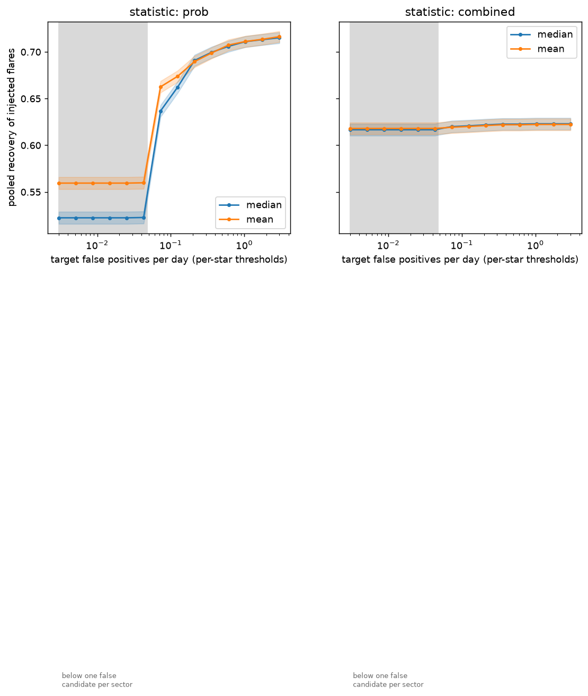

# Vetting flare candidates

The network gives a probability for every cadence, and `FitFlares` turns runs of
high probability into candidates. Neither is a vetting step: on flux-inverted light
curves, where every detection is false, `FitFlares` still accepts a few tenths of a
candidate per day on active stars. This page describes the columns that every
candidate carries, how to choose a cut **for one star** with its own receiver
operating characteristic (ROC), and what the cut does not cover.

## Candidate table columns

`FitFlares.flare_table` (and the table returned by `stella.pipeline.predict_and_mark`) has:

| column | meaning |
|---|---|
| `Target_ID`, `tpeak`, `amp`, `ed_s`, `rise`, `fall`, `prob` | as before: peak time, peak of the detrended flux, equivalent duration of the fit in seconds, fitted rise and fall in days, probability at the peak |
| `prob_max` | highest ensemble probability in the candidate's group (statistic `"prob"`) |
| `snr_peak` | peak significance in sigma above a 6 h running median (statistic `"snr"`); sigma is the MAD of the residuals within 0.5 d of the peak, excluding 30 min either side |
| `n_consec_3sigma` | length of the run of consecutive cadences at or above 3 sigma that contains the peak cadence (counted before and after it) |
| `n_above` | cadences at or above the threshold in the group |
| `dist_gap` | cadences from the peak to the nearest gap or end of the light curve |
| `fit_at_bound` | the fitted rise or fall sits at its upper bound, so the duration and equivalent duration are lower limits (lower bounds are not flagged: a rise shorter than a cadence is unresolved; the lower bound of the rise is reported separately in `rise_unresolved`) |
| `rise_unresolved` | the fitted rise sits at its lower bound. This is a separate flag: `fit_at_bound` is unchanged and still covers the upper bounds only. The fit starts the rise at its lower bound when the normalised flux at the peak is 1.5 or below and cannot move it from there, so almost every such flare carries the flag whatever its true rise, and `rise` is just the starting value. Only for flares with peak flux above 1.5 does the flag mean that the rise is shorter than the fit can resolve and `rise` is an upper limit |
| `near_dip` | (`predict_and_mark` only) within 0.1 d of a dip found by `stella.diagnostics.dip_diagnostics` |

`flare_table.meta` has `eclipse_like` and `n_dips`: two or more short, deep dips in the
light curve (eclipses, transits). These are **flags**; nothing is deleted. Eclipsing
and transiting systems should be excluded or masked before flare rates are
measured: stella was not trained on them and the probability reaches 1 at eclipse
ingress and egress. `diagnostics.dip_diagnostics` also returns `dips_periodic`
(four or more dips that fit one period, or two phases of one; random dip times pass a few per cent of the time), for information only. Running medians are taken within contiguous segments, so a gap does not create a step.

The statistics are stored as columns so that a cut can be changed later without rerunning the network.

## Per-star ROC

`stella.vetting.flare_roc` builds the ROC of a candidate-acceptance statistic for one
star's light curve:

* **False positives** come from the *flux-inverted* light curve of the same star,
  `2 * baseline - flux`, where the baseline is a running median (built per contiguous segment) from which
  flares are masked (`stella.diagnostics.local_baseline`). Real flares become dips,
  so every candidate accepted on the inverted curve is false. They are reported as
  a rate per day of *scored* time.
* **True positives** come from artificial flares (Davenport et al. 2014 template by default,
  or any `template(time, tpeak, fwhm_days, amplitude)`) injected one at a time into the
  *real* light curve, on a grid of fractional amplitudes and FWHMs, and recovered when
  `FitFlares` accepts a candidate within 0.01 d of the injected peak. Injections go at
  random places that are scored by the network and at least 80 cadences from a real
  candidate with probability at least 0.5.
* The statistic is selectable:
  `"prob"` (CNN probability), `"snr"` (peak significance in sigma),
  `"combined"` (at least two consecutive cadences at 3 sigma, then `snr_peak` is the
  statistic).

```python
import numpy as np
import stella
from stella import pipeline, vetting

# t, f, e: one star's light curve, quality-masked with stella.pipeline.FLARE_SAFE_BITMASK
roc = vetting.flare_roc(t, f, e, n_injections=240, seed=0)   # median ensemble, floor 0.1

roc.curve("combined")                      # Table: threshold, fp_rate (per day, with fp_lo/fp_hi),
                                           # recovery (with intervals), recovery@<amplitude>
thr = roc.threshold_for_fp_rate(0.05, statistic="combined")        # at most 0.05 false positives/day
thr_fn = roc.threshold_for_fn_fraction(0.2, amplitude=0.01)        # recover 80% of 1% flares
roc.operating_point("combined", thr)       # fp rate and recovery (overall and per amplitude)

# the star's own candidates, made at the same floor and with the same aggregate
*_, table = pipeline.predict_and_mark(stella.models.models, t, f, e,
                                      threshold=roc.meta["base_threshold"])
table = roc.apply(table, "combined", thr)  # adds a boolean column "vetted"; drop=True keeps only those
roc.plot("combined")                       # recovery against false positives per day
```

Arguments worth knowing: `aggregate` (`"median"`, `"mean"` or a sequence, which shares the network
passes and returns a dict), `base_threshold` (the probability at which candidates are generated; the
floor of every statistic), `amplitudes` and `fwhm_minutes` (the injection grid; defaults 0.3, 1, 3,
10% and 2, 6, 20 min), `n_injections` (total, rounded up to a multiple of the number of grid cells),
`seed`, `ci` (interval level, default 0.68), `scorer` (any object with `score(X)`).

Cost: the real, inverted and injected passes reuse the windowing of `ConvNN.predict`. An injection
rescores only the windows that contain the flare (about 300), so 240 injections cost about 3 scored
light curves of 18000 cadences, plus one each for the real and inverted curve.

### Limits

* Inversion only measures false positives from sources that are **symmetric about the baseline**:
  noise, and variability faster than about half of the 6 h baseline window (3 h), and many
  systematics. Slower variability, including most **rotational modulation**, is part of the
  running-median baseline and is left as it is, not inverted. Asymmetric sources (eclipse egress,
  asteroid crossings, scattered-light ramps, cosmic rays, contaminating flares from neighbours) are
  **not** measured either. The false-positive rate is a lower bound. `vetting.inversion_diagnostic(t, f, ax=ax)`
  overlays the flux, the baseline and the inverted flux, to check them across rotational extrema and gaps.
* The baseline is built separately in each contiguous segment (a step of more than 5.5 cadences is a
  gap), and injections need a gap-free stretch of about 0.5 d plus the network window on either side.
  The flux is normalised by one median over the whole input: for several sectors, normalise each first.
* The 80-cadence exclusion around injections covers every real candidate made at `base_threshold` as well
  as cadences with probability at least `avoid_threshold`, so a weak real candidate is not credited as a recovery.
* Real flares appear as dips in the inverted curve. The baseline masks them
  (`local_baseline`), but a flare lasting more than about half of the 6 h window, or a star that flares
  almost continuously, still lifts the baseline; check `roc.meta["frac_above_baseline"]`.
* The statistics `"snr"` and `"combined"` are conditional on the network having produced a candidate at
  `base_threshold`.
* A star with little observing time gives a coarse curve. The false-positive rate is a Poisson
  count over the exposure, with exact (Garwood) intervals; with no false candidate the upper limit is
  about 1.8 / exposure. Recoveries use Clopper-Pearson intervals. Rates much below one per exposure
  cannot be resolved; `threshold_for_fp_rate(..., bound="upper")` is the conservative choice.
* Recovery is for the injected template, not for real flares.

## Median or mean ensemble

The default aggregate of `predict_ensemble` and `predict_and_mark` is the median, as in the published
method. `examples/roc_median_vs_mean.py` compares the two on 25 public TESS star-sectors (18 stars, 526 d,
no eclipsing binaries), with each star's threshold chosen on its own inverted light curve.

* Statistic `"prob"`: at 0.1 false positives per day the median recovers 0.66 of the injected flares and the
  mean 0.67; at 0.01 per day (below one false candidate per sector, so the cut sits above every false
  candidate) 0.52 and 0.56. Paired over the 18 stars (a star seen in two sectors counts once), the median
  minus the mean is -0.016 +- 0.019 at 0.1/day and -0.052 +- 0.038 at 0.01/day: the mean is nominally higher,
  by less than 1.5 standard errors.
* Statistic `"combined"`: the two are indistinguishable (+0.001 +- 0.001 and -0.002 +- 0.003).
* The thresholds are in-sample, so the realised false-positive rate of 0 at low targets holds by construction.
  Applying the threshold from one sector of a star to its other sector (14 pairs, 290 d), the realised rate is
  0.031 per day (median) and 0.035 (mean) for a 0.01 target and `"prob"`, 0.079 and 0.097 for a 0.1 target, and
  0 within 0.006 for `"combined"`.

The difference is not significant, so the median stays the default. (A first run of this comparison, before
the review fixes to group merging, injection sites and the run-length statistic, had the median ahead by
about 2 standard errors at 0.1/day; the sign of a difference this small changes with such details, which is
a further reason to keep the published default rather than a tuned one.)



The shaded band is below one false candidate per sector, where a target cannot be resolved on one star's curve.

## Rotation periods

The Lomb-Scargle periods of `stella.MeasureProt` are not reliable for eclipsing binaries (they return half
the orbital period with a good flag) or for slow rotators. Do not use them to set detrending windows;
use a published period.
